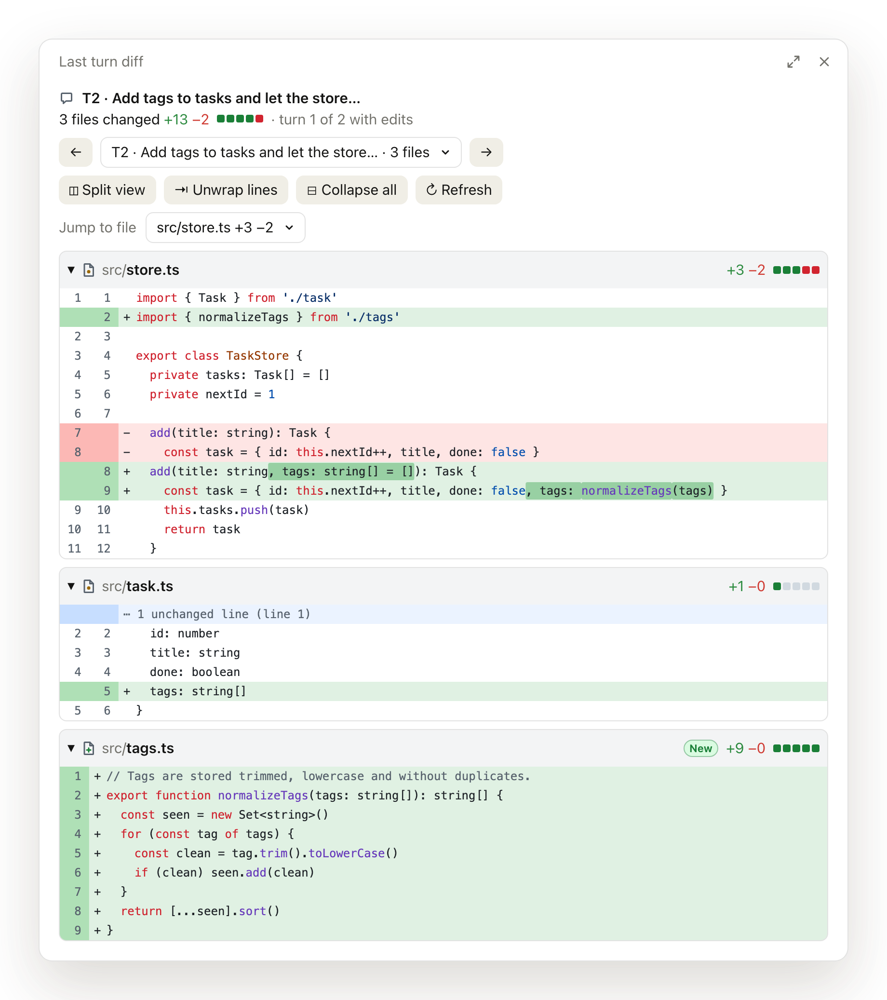
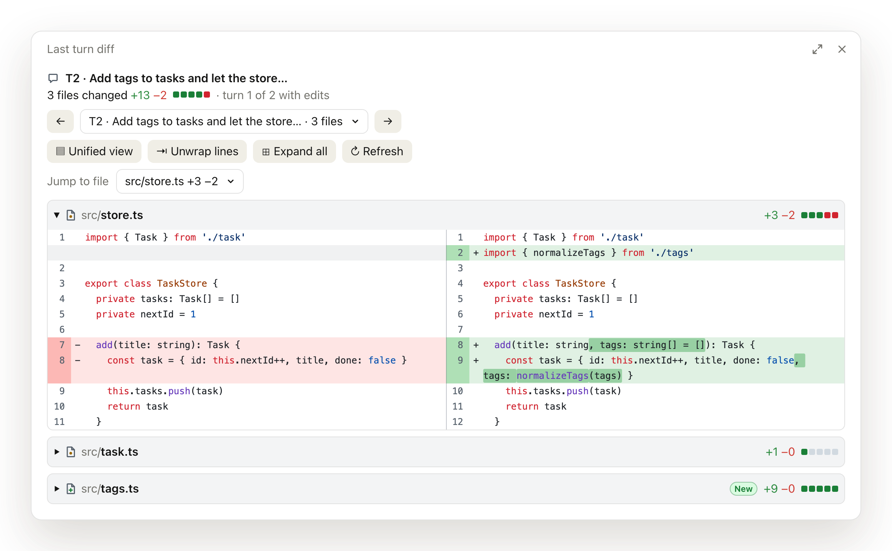
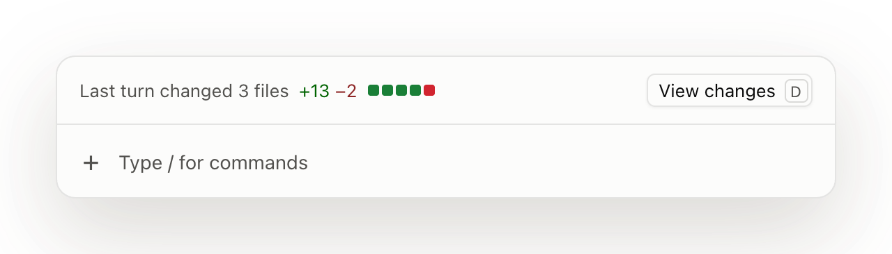
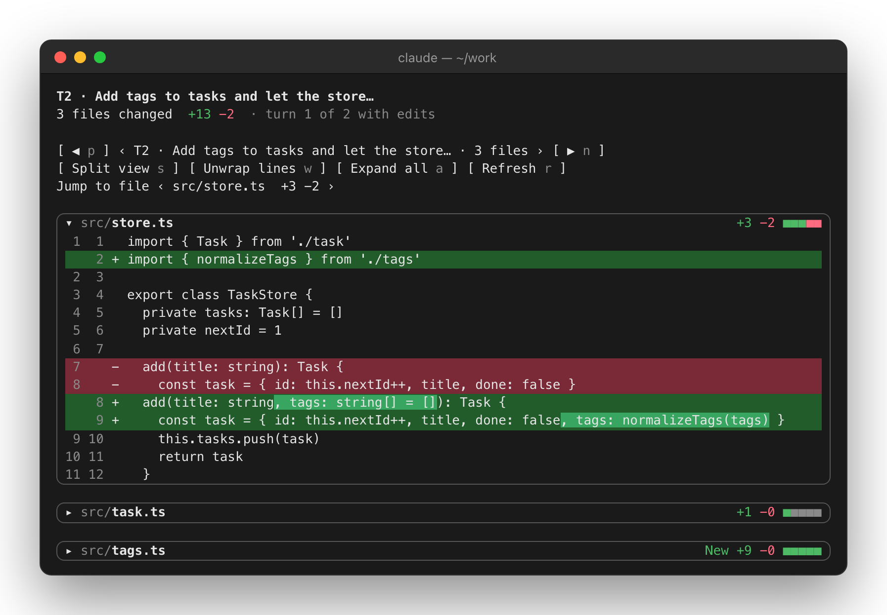

<div align="center">

# last-turn-diff

**See exactly what Claude just changed.**<br>
A GitHub-style diff of every file Claude edited in the last turn, right inside Claude Code.<br>
In Claude Desktop's Code tab and in the terminal. No git needed.

[](https://github.com/RomuloDrumond/claude-last-turn-diff/releases)
[](https://claude.com/claude-code)
[](#in-the-terminal)
[](LICENSE)

<picture>
  <source media="(prefers-color-scheme: dark)" srcset="docs/images/pane-dark.png">
  
</picture>

</div>

## Install

```
/plugin install last-turn-diff --marketplace RomuloDrumond/claude-last-turn-diff
```

Run it in the terminal or in a Claude Desktop Code session (Claude Code 2.1.286 or later; in Desktop, 2.1.299 or later draws the lines as text rather than pictures), then `/reload-plugins`. After Claude edits files, click **View changes** above the prompt or run `/lastturn`.

## What you get

- **One card per file**, GitHub style: old and new line numbers, green and red rows, the changed words marked inside a reworded line, and `⋯ 23 unchanged lines` where the diff skips ahead.
- **Every turn, not just the last.** Step back through earlier turns with the arrows or the turn picker. Each is labelled with the first words of its prompt.
- **Split or unified**, wrapped or cut, collapsed or expanded. Your split and wrap choices are remembered across sessions.
- **Made for Desktop.** Each file's lines are Desktop's own text in its code face, with syntax colours that follow your light or dark theme, plus file icons, diffstat squares and a New badge.
- **Copy with a click in Desktop.** Click a line number to copy that line's code, **Copy hunk** to copy one hunk, or **Copy diff** in a file's header to copy the file's whole diff as a unified diff. Desktop doesn't let you select text in a plugin's pane (see [Limits](#limits)), so these buttons are how you copy there.
- **Works in the terminal too**, with the same pane drawn in your theme's diff colours, with hotkeys for its buttons.
- **No git required.** Diffs come from Claude's own Edit, Write and NotebookEdit calls, so you see only what Claude did, even in a dirty working tree or outside a repository.

### Split view

<picture>
  <source media="(prefers-color-scheme: dark)" srcset="docs/images/split-dark.png">
  
</picture>

### A hint after every turn with edits

<picture>
  <source media="(prefers-color-scheme: dark)" srcset="docs/images/band-dark.png">
  
</picture>

The hint disappears after a turn that edited nothing.

### In the terminal



## Controls

| Button | Terminal key | What it does |
| --- | :---: | --- |
| `←` `→` and the turn picker | `p` `n` | Step through earlier turns with edits |
| `Split view` / `Unified view` | `s` | Old file beside the new one, or interleaved. Needs a pane 90 columns wide (64 for Desktop's pictures before 2.1.299). New files are always unified. |
| `Unwrap lines` / `Wrap lines` | `w` | Cut long lines at the pane's edge, or wrap them. Split view in Desktop's text (2.1.299 and later) always cuts them, so there it hides this button. |
| `Collapse all` / `Expand all` | `a` | Fold every card. Click a card's path to fold just that one. |
| `Jump to file` | | Open a file and scroll to its card. A turn of more than 64 files lists the 64 around the current one. |
| `Refresh` | `r` | Read the transcript again and add any turn with edits that wasn't recorded live |
| `Previous file` / `Next file` | `k` `j` | Shown for large turns, which show one file at a time |
| A line number, `Copy hunk`, `Copy diff` | | Desktop only. Copy a line's code, one hunk with its `@@` header, or the file's diff with its `---`/`+++` header. `Copy hunk` leads each hunk of a file that has more than one. Before 2.1.299, only `Copy diff`. |

A turn whose files add up to more than 400 changed lines, or to more than Desktop can draw at once, shows one file at a time. A long file shows up to 150 lines at a time. Desktop refuses a pane of 2,000 elements or more and keeps showing the old one, so there a page ends sooner when its lines are dense: about 100 lines of code rich in colours, about 50 in split view. Hotkeys work in the terminal only.

## Limits

- **Only Edit, Write and NotebookEdit calls are recorded.** The mod doesn't see changes made through the shell (sed, formatters, `git checkout`, code generators), MCP tools, other plugins, or you.
- **Other changes can mix into the diff.** If something else changes a file between two of Claude's edits to it in the same turn, that change also appears in the file's diff for that turn.
- **Subagent edits are lost on a reload.** They are recorded while the session runs, but the main transcript doesn't store them, so they can't be read back.
- **Text in Desktop's pane can't be selected.** Desktop turns off text selection for its whole window and turns it back on only in the chat, so nothing in a plugin's pane can be selected, by dragging, double-clicking or triple-clicking. Use the copy buttons instead.
- **Desktop draws pictures before Claude Code 2.1.299.** Older builds refuse the code face, so there each file's lines are an image, and only `Copy diff` copies from them.
- **Long lines are kept cut.** A line over 400 characters is stored as its first 400, so it is drawn and copied that way, and a copy that includes one says so.
- **Colours are per line.** A string or comment that spans lines is coloured line by line, so only its first line may be coloured right. In Desktop's text, a line dense with colours (a table of numbers, say) is drawn without them, and one with many changed words marks them as one stretch.
- **Cut lines may lose their ellipsis.** When Desktop cuts a line inside a coloured string or comment, or inside a marked change of several words, the line can end short of the edge without `…`. Its line number still copies the whole line.
- **Notebook edits are shown per cell.** The diff covers the cell source only, not the notebook JSON.
- **Size caps:** the 30 newest turns with edits are kept; a file over 2 MB is listed without a diff; each file keeps about 150,000 characters of hunks, and each turn about 600,000.

<details>
<summary><b>How it works</b></summary>

<br>

- A `tool.call` hook reads the file before Edit or Write runs, lets the call through unchanged, and then reads the file again. Calls that were denied, failed, or held for review (`staged`) are skipped.
- No hook changes what Claude Code or the model sees. `tool.call`, `turn.start`, `turn.complete` and `classic.SessionStart` pass each event on unchanged; `classic.SessionStart` only reads why the session started, to empty the list after `/clear` or read it back after `/resume` or a fork. The `command.run` hook matches only `/lastturn`, the command the mod registers, and answers it by opening the pane. The `ui.render` hooks draw the pane and the hint above the prompt, and the hint steps aside when Claude Code shows a survey there.
- Edits are grouped by turn, from `turn.start` to `turn.complete`. Each file's diff compares the file before its first edit in the turn with the file after its last edit in the turn. A small Myers diff in plain TypeScript computes it, with no dependencies.
- When a session starts, after `/resume`, or after a fork, the mod reads the turns back from the transcript (`$.session.messages()`). It uses the `originalFile` and `content` fields that Edit and Write store there, so the pane survives a reload. `/clear` empties the list.
- The terminal pane draws `Box`, `Text`, `Button` and `Select`. Desktop draws the same controls, and its icons are small `Svg` elements beside the text (`hooks/icons.ts`). The theme's diff colours are opaque fills made for a terminal, and they drown the text in a Desktop pane, so Desktop gets GitHub's translucent tints instead. The `Code` element's diff format draws a plain code block there, with no tints or line numbers.
- In Desktop each line is a row of `Text` in the code face (`mono`, `hooks/text.tsx`), its syntax colours theme keys that follow light and dark; a changed word keeps the text's own colour on its mark, where a syntax colour is hard to read in the dark theme. Its line numbers and sign are the label of a plain `Button`, and pressing one copies the line with `$.ui.copy`; the row that leads each hunk ends in a `Copy hunk` button, and each card's header has `Copy diff`. Desktop's window sets `user-select: none` and only its transcript sets it back, so nothing a plugin draws in a pane can be selected. Split view puts each side's rows in a column of its own, one line high, its numbers then its code.
- The mod asks `$.session.version()` once per load. Claude Code 2.1.295 refuses `mono`, and one refused prop replaces the whole pane with the engine's own, so before 2.1.299, when the version can't be read, and on the other graphical surfaces, each file's lines are an `Svg` picture instead (`hooks/svg.ts`). The picture is as wide as the card, drawn 1:1; the mod estimates the card's width from the pane's `bodyColumns` (about 8 CSS pixels a column) only to decide where long lines wrap.
- Desktop refuses a pane of 2,000 elements, 32 levels or 262,144 characters or more, and keeps showing the old one; the engine blanks a tree's text past its first 100,000 characters, labels and picture descriptions included. `hooks/size.ts` counts each row's elements as Desktop and the engine do. A page ends before it would no longer fit beside the rest of the pane when its file is shown alone, several files show at once only when all of them fit open, and `Jump to file` names at most the last 80 characters of a path.
- A `Button` can hold only text: the engine refuses an `Svg` inside one. So Desktop's buttons start with a glyph (`↻ Refresh`, `◫ Split view`, `⊟ Collapse all`), and the icons sit beside them.
- `hooks/syntax.ts` colours keywords, strings, comments, numbers, and function and type names for a handful of language families (JS/TS, C-like, Python, shell, Ruby, SQL, CSS, YAML/TOML/JSON), one line at a time.

</details>

<details>
<summary><b>Develop</b></summary>

<br>

Load the mod from a checkout. In the **terminal**, for one session:

```bash
claude --plugin-dir /path/to/claude-last-turn-diff
```

**Claude Desktop** doesn't accept `--plugin-dir`. Add the folder to `CLAUDE_CODE_PLUGIN_DIRS` under `env` in `~/.claude/settings.json` instead (separate several folders with `:`), then run `/reload-plugins` or start a new Desktop session:

```json
{
  "env": {
    "CLAUDE_CODE_PLUGIN_DIRS": "/path/to/claude-last-turn-diff"
  }
}
```

Validate and test:

```bash
claude plugin validate .
claude plugin test .
```

Desktop runs its own bundled Claude Code, which can be older than the `claude` on your PATH. Validate with that build too, because an older engine can refuse a module a newer one loads (2.1.295 refuses passing `$` into a function imported from another file, which is why `hooks/view.tsx` never holds `$`; it also refuses `Text` props such as `mono` and `size` and a `gap` given as a name like `'xs'`, so the mod draws pictures there). In a Desktop session, `$CLAUDE_CODE_EXECPATH` names that build:

```bash
"$CLAUDE_CODE_EXECPATH" plugin validate .
```

The tests in `tests/` simulate Edit and Write tool calls and turn boundaries, then read the drawn pane on both the terminal and desktop surfaces. On the terminal they check the rows, tints and word marks; on Desktop, the text (gutter buttons, tints, marks, colours, copying a line, a hunk or a file's diff) and the pictures drawn before 2.1.299. Both cover split view, wrap, collapse all, jump to file, the large-turn mode, refresh and the turn picker, and dense or long files page by page. Every tree drawn on the desktop must pass a port of Desktop's own size checks (`tests/desktop-limits.ts`) and keep its text within what the engine draws. On 2.1.295, which refuses `mono`, the text tests print a note and stop at their mount, and the tests of the controls run on the pictures. They also test the SVG renderer, the highlighter and the turn titles directly.

When the engine loads the mod, it writes `.claude-plugin/types/` and a `tsconfig.json`. After that, `tsc -p .` type-checks the mod. Git ignores both generated files.

The images in this README are drawn from the mod's real output. `docs/screenshots/fixture.ts` mounts the pane on a small made-up project, and `make.ts` draws what it prints as pages styled like Claude Desktop and a terminal, then photographs them with headless Chrome. After changing the UI, rebuild them:

```bash
cd docs/screenshots && bun install && bun make.ts
```

It runs `claude plugin test`, so it needs Claude Code 2.1.299 or later (set `CLAUDE_BIN` to use another build): older engines refuse the text the fixture draws.

To release, bump `version` in `.claude-plugin/plugin.json` and run `claude plugin tag --push .`. Installs are cached by version, so bump it for every release.

</details>

## Credits

This mod borrows the idea of recording edits at `tool.call` and replaying them in a pane from Anthropic's replay-theater sample mod (Apache-2.0). No code is copied from it.

Released under the [MIT License](LICENSE).
